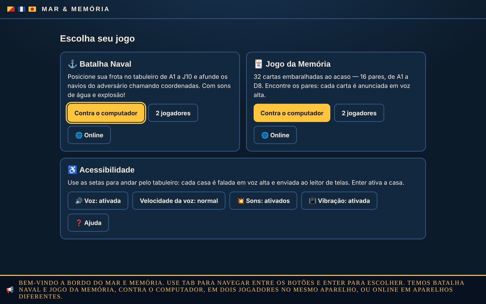

# Mar & Memória 🌊🧠

Batalha Naval e Jogo da Memória acessíveis por coordenadas faladas, para que pessoas
cegas e videntes joguem juntas — no mesmo aparelho, contra o computador ou **online,
cada um no seu aparelho**.



## Estrutura do projeto

```
mar-e-memoria/
├── server.js          → servidor Node.js (Express + Socket.IO) do modo online
├── package.json       → dependências e scripts
├── teste-online.js    → teste automatizado que simula 2 jogadores online
└── public/
    └── index.html     → o jogo completo (HTML + CSS + JS num arquivo só)
```

## Rodando no seu computador

Pré-requisito: Node.js 18 ou mais novo (https://nodejs.org).

```bash
npm install
npm start
```

Depois abra http://localhost:3000 no navegador. Para testar o modo online
localmente, abra o mesmo endereço em duas abas ou dois navegadores.

Para rodar o teste automatizado (com o servidor já rodando em outro terminal):

```bash
npm test
```

Ele simula duas pessoas jogando uma Batalha Naval inteira e um Jogo da Memória
inteiro, e confere sala inexistente, vez dos jogadores e fim de jogo.

> Observação: abrir o `public/index.html` direto como arquivo também funciona,
> mas só nos modos locais (mesmo aparelho / contra o PC). O modo online precisa
> do servidor — o próprio jogo avisa isso.

## Hospedagem gratuita no Render

O modo online usa WebSocket (Socket.IO), então precisa de um servidor Node —
hospedagem só de arquivos estáticos (como GitHub Pages) não serve para o online.
O Render tem plano gratuito que atende bem:

1. **Suba o projeto para o GitHub**
   - Crie um repositório novo (por exemplo `mar-e-memoria`).
   - Envie estes arquivos: `server.js`, `package.json`, `teste-online.js`,
     `.gitignore` e a pasta `public/`. **Não** envie a pasta `node_modules`
     (o `.gitignore` já cuida disso).

2. **Crie o serviço no Render**
   - Acesse https://render.com e entre com a conta do GitHub.
   - Clique em **New → Web Service** e escolha o repositório.
   - Preencha:
     - **Language**: Node
     - **Build Command**: `npm install`
     - **Start Command**: `npm start`
     - **Instance Type**: Free
   - Clique em **Deploy Web Service**.

3. **Pronto!** O Render gera um endereço tipo
   `https://mar-e-memoria.onrender.com`. É esse link que você compartilha:
   uma pessoa cria a sala, fala o código de 4 letras, e a outra entra do
   próprio celular ou computador.

Detalhes do plano gratuito do Render:
- O serviço "dorme" após ~15 minutos sem uso; o primeiro acesso seguinte
  demora uns 30–50 segundos para acordar. Depois disso, funciona normal.
- Dica: cadastre o link num monitor gratuito como o UptimeRobot
  (https://uptimerobot.com) pingando a cada 10 minutos — assim o serviço
  quase nunca dorme e abre rápido para todo mundo.
- Cada atualização no GitHub (git push) publica uma versão nova sozinha.

Variáveis de ambiente opcionais do servidor: `TEMPO_VEZ_MS` (tempo por jogada
no online, padrão 60000) e `QUEDA_MS` (espera de reconexão, padrão 45000).

## Recursos dos jogos

**Batalha Naval**
- Contra o computador em 3 dificuldades: fácil (atira ao acaso), médio (caça os
  navios após acertar) e difícil (estrategista, varre em padrão xadrez).
- Faixa visual da frota nos dois lados (quadradinhos verdes/vermelhos por casa).
- Animação de naufrágio casa a casa quando um navio afunda, com super explosão.

**Jogo da Memória**
- **Cada bicho tem a sua própria nota musical** (escala de dó maior, 2 oitavas):
  dá para memorizar pela coordenada falada E pelo som — pensado para jogadores
  cegos jogarem de ouvido.
- Dois tamanhos nos modos locais: rápido (8 pares, 4×4) e completo (16 pares, 4×8).
- Estatísticas faladas no fim: lances, tempo e aproveitamento.

**Modo online (os dois jogos)**
- **Revanche** na mesma sala, mantendo os nomes, sem digitar código de novo.
- **Reconexão automática**: se a internet piscar, o servidor guarda a partida por
  até 45 segundos e entrega tudo o que aconteceu quando o jogador volta.
- **Tempo limite de 1 minuto por jogada**, com aviso falado 15 segundos antes;
  se estourar, a vez passa sozinha.

**Geral**
- Vibração no celular nos acertos, explosões e pares (dá para desligar no menu).
- **PWA**: dá para "instalar" o jogo no celular (ícone na tela inicial) e os
  modos locais funcionam até sem internet.

## Nomes dos jogadores (login provisório)

Antes de criar ou entrar numa sala, cada jogador digita um nome. Esse nome:
- vale **só para aquela partida**;
- fica guardado **apenas na memória do servidor** enquanto a sala existe;
- é apagado junto com a sala quando alguém sai — **nada vai para banco de
  dados ou arquivo**.

Se os dois escolherem o mesmo nome, o servidor renomeia o segundo
automaticamente (ex.: "Wagner" e "Wagner 2").

## Como o modo online funciona (resumo técnico)

- O `server.js` serve a pasta `public/` e mantém as **salas** em memória.
- `sala:criar` gera um código de 4 letras; `sala:entrar` junta o segundo jogador.
- Na Batalha Naval, cada cliente envia a frota (`bn:frota`); o servidor guarda
  as duas, sorteia quem começa (`bn:comecar`) e julga cada tiro (`bn:tiro` →
  `bn:resultado` com água/acerto/afundou, vez e fim de jogo).
- No Jogo da Memória, o servidor embaralha as 32 cartas (16 pares) e julga cada
  virada (`mem:virar` → `mem:carta` e `mem:resultado`); quem acha par joga de novo.
- O árbitro é sempre o servidor: nenhum cliente enxerga a frota do adversário
  nem as cartas fechadas, o que evita trapaça.

## Acessibilidade

- Todas as coordenadas e resultados são falados por síntese de voz.
- Navegação completa por teclado (setas, Enter, R para girar, A para
  posicionar ao acaso, S para situação/placar, C para repetir a coordenada).
- Sons distintos: água, explosão, super explosão de navio afundado e par
  encontrado.
- Navios desenhados por imagens SVG embutidas no próprio código — casco com
  linha d'água, torre de canhão, ponte de comando, âncora, bandeira e boia —
  sem depender de arquivos de imagem externos.
